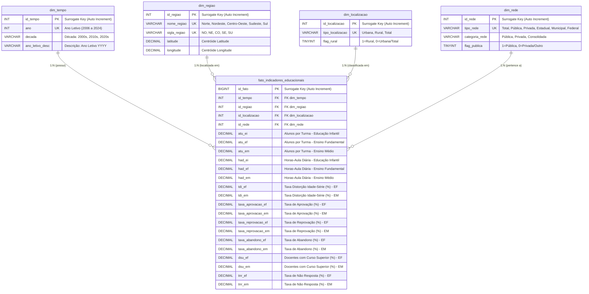

# 📐 Documentação de Modelagem Relacional — Esquema Estrela (Star Schema)

## Diagrama Entidade-Relacionamento (DER) & Dicionário de Dados
### Projeto: Indicadores Educacionais por Região (INEP / MEC)
### Camada Ouro (Gold) — SGBD Alvo: MySQL 8.0+ / SQLite 3

---

## 1. Visão Geral da Modelagem Dimensional

A Camada Ouro foi projetada estritamente segundo as melhores práticas de modelagem dimensional de Ralph Kimball (**Star Schema / Esquema Estrela**). Essa abordagem desacopla o contexto dimensional das métricas agregadas, permitindo alta performance em consultas analíticas OLAP e simplificação drástica da navegação em ferramentas de BI (Microsoft Power BI).

O modelo é composto por:
* **4 Tabelas Dimensão** (`dim_tempo`, `dim_regiao`, `dim_localizacao`, `dim_rede`).
* **1 Tabela Fato Central** (`fato_indicadores_educacionais`).
* **2 Views Analíticas Corporativas** (`vw_indicadores_completos`, `vw_kpis_regionais_recente`).

---

## 2. Diagrama Entidade-Relacionamento (DER)

---

## 3. Dicionário de Dados e Restrições de Integridade

### 3.1 Tabelas Dimensão

#### `dim_tempo`
* **Descrição**: Representa o grão temporal dos censos escolares anuais do INEP.
* **Volume**: 19 registros (2006 a 2024).
* **Restrições**: `id_tempo` (PRIMARY KEY), `ano` (UNIQUE, NOT NULL), `CHECK (ano BETWEEN 1990 AND 2100)`.

#### `dim_regiao`
* **Descrição**: Macrorregiões geográficas oficiais do Brasil conforme divisão IBGE.
* **Volume**: 5 registros (Norte, Nordeste, Centro-Oeste, Sudeste, Sul).
* **Restrições**: `id_regiao` (PRIMARY KEY), `nome_regiao` (UNIQUE, NOT NULL), `sigla_regiao` (UNIQUE, NOT NULL).

#### `dim_localizacao`
* **Descrição**: Segmentação territorial das escolas brasileiras.
* **Volume**: 3 registros (`Urbana`, `Rural`, `Total`).
* **Restrições**: `id_localizacao` (PRIMARY KEY), `tipo_localizacao` (UNIQUE, NOT NULL).

#### `dim_rede`
* **Descrição**: Dependência administrativa das unidades escolares.
* **Volume**: 6 registros (`Total`, `Pública`, `Privada`, `Estadual`, `Municipal`, `Federal`).
* **Restrições**: `id_rede` (PRIMARY KEY), `tipo_rede` (UNIQUE, NOT NULL).

---

### 3.2 Tabela Fato (`fato_indicadores_educacionais`)

* **Descrição**: Tabela fato transacional acumulada com granularidade atômica definida por:
  $$\text{Granularidade} = \text{Ano} \times \text{Região} \times \text{Localização} \times \text{Rede}$$
* **Volume**: 1.710 registros consolidados.
* **Chave Primária**: `id_fato BIGINT AUTO_INCREMENT`.
* **Chave Natural Única (Idempotência)**:
  `CONSTRAINT uq_fato_chave_natural UNIQUE (id_tempo, id_regiao, id_localizacao, id_rede)`.
* **Chaves Estrangeiras**:
  * `fk_fato_tempo` -> `dim_tempo(id_tempo)` (`ON UPDATE CASCADE ON DELETE RESTRICT`)
  * `fk_fato_regiao` -> `dim_regiao(id_regiao)` (`ON UPDATE CASCADE ON DELETE RESTRICT`)
  * `fk_fato_localizacao` -> `dim_localizacao(id_localizacao)` (`ON UPDATE CASCADE ON DELETE RESTRICT`)
  * `fk_fato_rede` -> `dim_rede(id_rede)` (`ON UPDATE CASCADE ON DELETE RESTRICT`)
* **Índices de Performance**:
  * `idx_fato_tempo`, `idx_fato_regiao`, `idx_fato_localizacao`, `idx_fato_rede`.
  * Índice composto analítico: `idx_fato_analise_temporal (id_tempo, id_regiao, id_rede)`.

---

## 4. Glossário das Métricas da Tabela Fato

| Métrica | Nome Técnico | Unidade de Medida | Significado Educacional |
|---|---|---|---|
| **ATU** | Alunos por Turma | Média (estudantes/sala) | Densidade de alunos por turma; salas superlotadas reduzem a atenção individual. |
| **HAD** | Horas-Aula Diária | Média (horas/dia) | Tempo de permanência do aluno na escola; indicador direto de jornada ampliada/integral. |
| **TDI** | Distorção Idade-Série | Proporção (%) | Percentual de estudantes com atraso escolar igual ou superior a 2 anos. |
| **Aprovação** | Taxa de Aprovação | Proporção (%) | Percentual de alunos promovidos para a série subsequente ao final do ano letivo. |
| **Reprovação** | Taxa de Reprovação | Proporção (%) | Percentual de alunos retidos na mesma série por insuficiência acadêmica ou frequência. |
| **Abandono** | Taxa de Abandono (Evasão) | Proporção (%) | Percentual de estudantes que deixaram de frequentar a escola durante o ano letivo. |
| **DSU** | Docentes com Superior | Proporção (%) | Percentual de funções docentes ocupadas por profissionais com diploma de nível superior. |
| **TNR** | Taxa de Não Resposta | Proporção (%) | Percentual de escolas ativas que deixaram de prestar informações completas ao Censo. |
